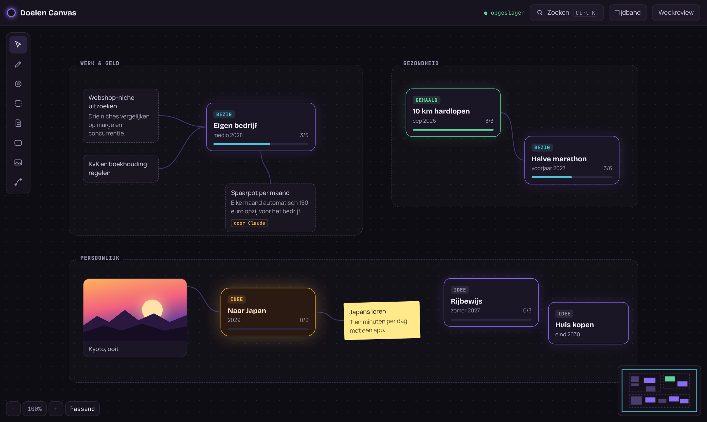
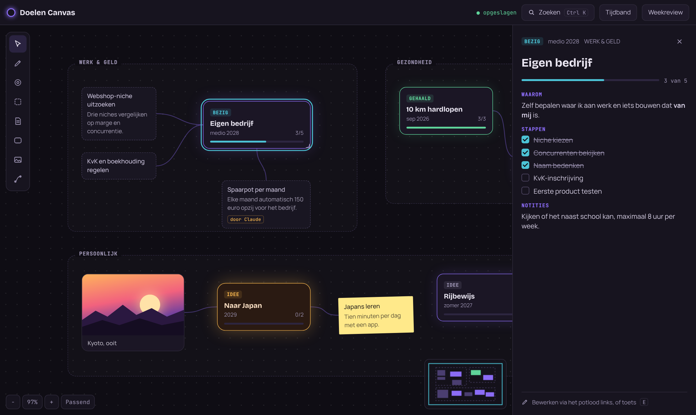
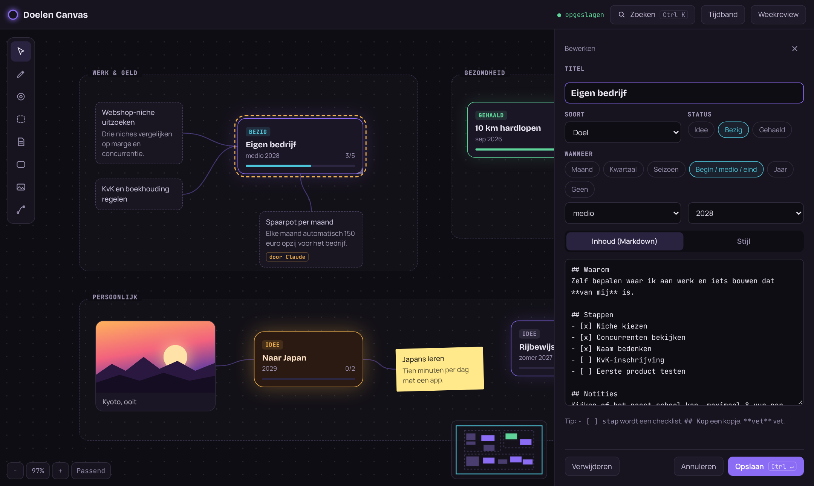
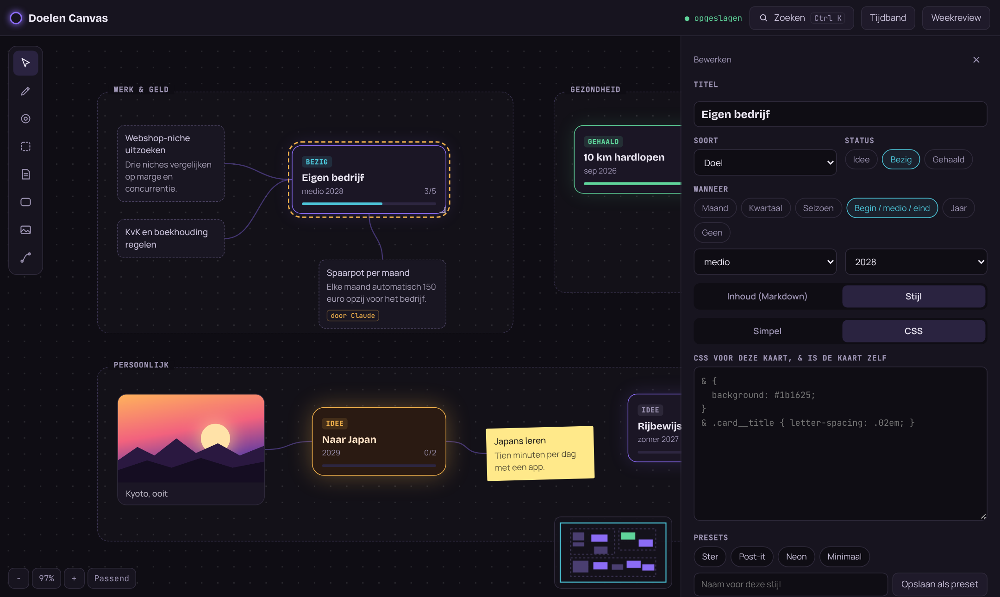
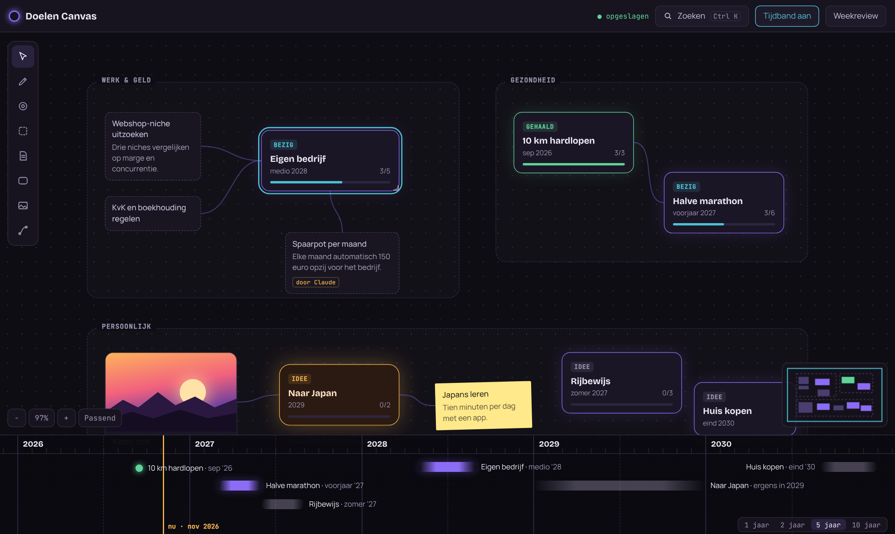
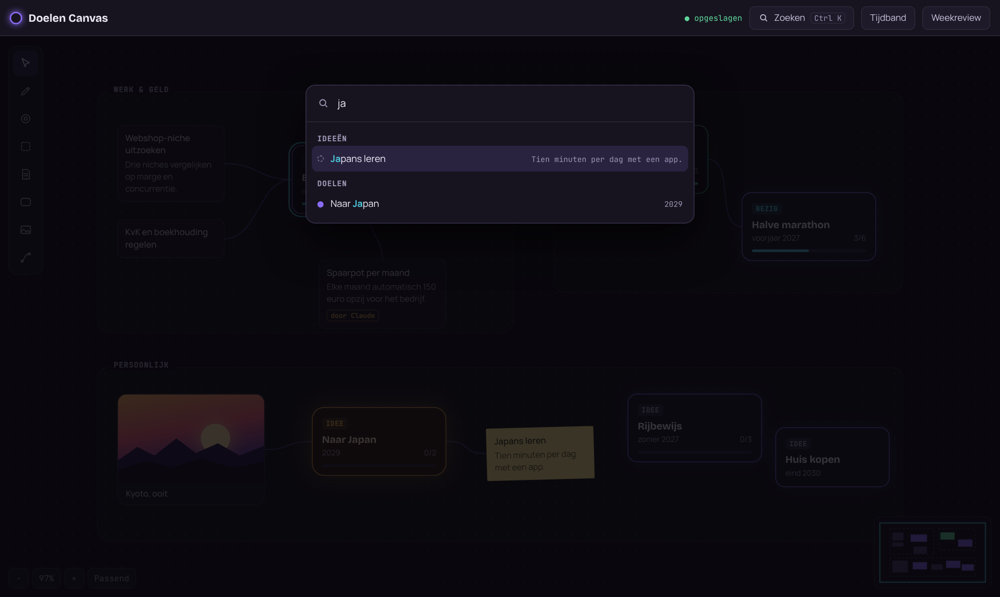
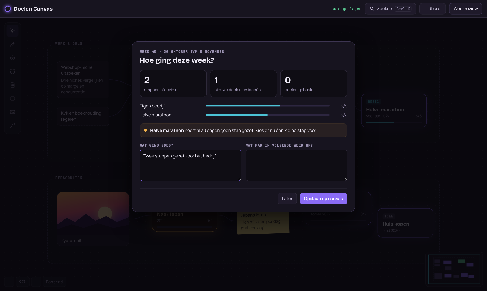

# Doelen Canvas

Local-first goal canvas: map goals and ideas on an infinite canvas, plan them on a fuzzy timeline and style every card with your own CSS. Goals are plain Markdown files with a REST API.

Een lege, oneindige canvas op je eigen computer waar je doelen en ideeën neerzet, ze aan elkaar koppelt en op een tijdband plant. Alles blijft lokaal staan als gewone Markdown-bestanden.



## Functies

- **Oneindige canvas**: pannen, zoomen, minimap en "Passend" om alles in beeld te zetten.
- **Doelen, ideeën, notities en afbeeldingen** als kaarten. Verbind ze met lijnen en groepeer ze in zones zoals "Werk & geld" of "Gezondheid".
- **Lezen en bewerken gescheiden**: klik op een doel om de inhoud en de checklist te zien. Bewerken gaat alleen via het potlood.
- **Markdown-inhoud**: elke `- [ ] stap` wordt een checklist die je direct kunt afvinken. De voortgangsbalk rekent mee.
- **Vage perioden in plaats van datums**: "voorjaar 2027", "medio 2028", "Q2 2027" of "2029".
- **Tijdband**: doelen staan als zachte balken over hun periode, met een lijn voor "nu".
- **Eigen stijl per kaart**: schuifjes of je eigen CSS, plus presets die je kunt opslaan.
- **Zoeken met Ctrl+K**, **weekreview**, **export als PNG** en **ongedaan maken**.
- **Claude kan meeschrijven** via de API of door een `.md`-bestand neer te zetten. De canvas werkt live bij.

## Snel starten

Je hebt [Node.js](https://nodejs.org) 18 of nieuwer nodig. Er zijn geen andere dependencies.

```bash
git clone https://github.com/ThijmenDEVONLEARN/doelen-ideen-canvas.git
cd doelen-ideen-canvas
npm start
```

Open daarna <http://localhost:4321>. Je begint met een lege canvas: dubbelklik ergens om je eerste doel te maken.

Wil je eerst rondkijken met voorbeelddoelen?

```bash
npm run demo
```

De demo gebruikt een kopie in `.demo-data/`, dus je eigen `data/` blijft onaangeraakt. Verwijder `.demo-data/` om de demo opnieuw te beginnen.

| Variabele  | Standaard     | Wat het doet                          |
| ---------- | ------------- | ------------------------------------- |
| `PORT`     | `4321`        | Poort van de server                   |
| `HOST`     | `127.0.0.1`   | Alleen bereikbaar vanaf je eigen pc   |
| `DATA_DIR` | `./data`      | Map waar je doelen worden opgeslagen  |

## Hoe je het gebruikt

### Een doel bekijken

Klik op een kaart. Rechts zie je de status, de periode, de zone en de inhoud. Vink stappen af in de checklist; dat wordt meteen opgeslagen.



### Een doel maken of bewerken

Bewerken kan alleen met het **potlood** in de gereedschapsbalk, met de toets <kbd>E</kbd> op een geselecteerde kaart of met een dubbelklik. Daar stel je de titel, soort, status en periode in, en schrijf je de inhoud in Markdown.



### Een kaart stylen

In het tabblad **Stijl** kies je kleuren, rand, hoeken, gloed en lettertype, of je schrijft zelf CSS. `&` staat voor de kaart zelf:

```css
& {
  background: #ffe98a;
  color: #2a2620;
  transform: rotate(-1.5deg);
}
& .card__title { letter-spacing: .02em; }
```

De CSS geldt alleen voor die ene kaart. Bewaar een stijl als preset om hem op andere kaarten te gebruiken.



### Tijdband

Zet de tijdband aan met de knop of <kbd>T</kbd>. Kies 1, 2, 5 of 10 jaar. Klik op een balk om naar het doel te springen. Doelen zonder periode worden op de canvas even vager, zodat je ziet wat nog geen plek in de tijd heeft.



### Zoeken en weekreview

<kbd>Ctrl</kbd>+<kbd>K</kbd> zoekt in alle titels en inhoud en kan ook acties uitvoeren. De **weekreview** laat zien hoeveel stappen je deze week hebt gezet, welk doel al drie weken stilstaat, en bewaart je antwoorden als notitie op de canvas.

| Zoeken | Weekreview |
| --- | --- |
|  |  |

### Sneltoetsen

| Toets | Actie |
| --- | --- |
| <kbd>V</kbd> | Selecteren en verplaatsen |
| <kbd>P</kbd> | Potlood: klik op een kaart om te bewerken |
| <kbd>E</kbd> | Geselecteerde kaart bewerken |
| <kbd>D</kbd> / <kbd>I</kbd> / <kbd>N</kbd> | Nieuw doel / idee / notitie (klik op de canvas) |
| <kbd>Z</kbd> | Zone tekenen (dubbelklik op de naam om te hernoemen) |
| <kbd>A</kbd> | Afbeelding toevoegen (of sleep of plak een afbeelding) |
| <kbd>L</kbd> | Twee kaarten verbinden |
| <kbd>T</kbd> | Tijdband aan of uit |
| <kbd>Ctrl</kbd>+<kbd>K</kbd> | Zoeken |
| <kbd>Ctrl</kbd>+<kbd>E</kbd> | Exporteren als PNG |
| <kbd>Ctrl</kbd>+<kbd>Z</kbd> / <kbd>Ctrl</kbd>+<kbd>Shift</kbd>+<kbd>Z</kbd> | Ongedaan maken / opnieuw |
| <kbd>Delete</kbd> | Geselecteerde kaart, lijn of zone verwijderen |
| <kbd>Spatie</kbd> + slepen | Pannen, ook boven kaarten |
| Scrollwiel | Zoomen |

## Doelen zijn Markdown-bestanden

Elk doel of idee is een bestand in `data/items/`. Je kunt ze dus ook openen in je editor, in een notitie-app of in git zetten.

```markdown
---
titel: Eigen bedrijf
type: doel
status: bezig
wanneer: medio 2028
stijl: |
  & { border-color: #f2b24c; }
---
## Waarom
Zelf bepalen waar ik aan werk.

## Stappen
- [x] Niche kiezen
- [ ] KvK-inschrijving
```

| Veld | Waarden |
| --- | --- |
| `type` | `doel`, `idee`, `notitie`, `afbeelding` |
| `status` | `idee`, `bezig`, `gehaald` |
| `wanneer` | `mrt 2027`, `Q2 2027`, `voorjaar 2027` (ook `zomer`, `najaar`, `winter`), `begin 2028`, `medio 2028`, `eind 2028`, `2029` |
| `afbeelding` | `/uploads/bestand.png` of een `https://`-link |
| `door` | `claude` toont het label "door Claude" |
| `stijl` | CSS voor deze kaart, `&` is de kaart |

Posities, lijnen, zones en presets staan in `data/canvas.json`. Afgevinkte stappen worden bijgehouden in `data/activity.json` voor de weekreview.

## Claude laten meeschrijven

De server heeft een kleine REST API op `http://localhost:4321/api`. Alles wat Claude (of een script) toevoegt, verschijnt meteen in open tabbladen.

```bash
# Nieuw idee, met het label "door Claude"
curl -X POST localhost:4321/api/items -H 'Content-Type: application/json' \
  -d '{"titel":"Spaarpot per maand","type":"idee","door":"claude","inhoud":"Elke maand 150 euro opzij.","x":300,"y":200}'

# Een stap afvinken of de status aanpassen
curl -X PATCH localhost:4321/api/items/eigen-bedrijf -H 'Content-Type: application/json' \
  -d '{"status":"gehaald"}'

# Twee kaarten verbinden
curl -X POST localhost:4321/api/links -H 'Content-Type: application/json' \
  -d '{"from":"spaarpot-per-maand","to":"eigen-bedrijf"}'
```

| Methode | Route | Wat het doet |
| --- | --- | --- |
| `GET` | `/api/state` | Alle items en de layout |
| `GET` | `/api/items` | Alle items |
| `GET` | `/api/items/:id` | Eén item |
| `POST` | `/api/items` | Item maken (velden hierboven, optioneel `x`, `y`, `w`) |
| `PATCH` | `/api/items/:id` | Velden van een item aanpassen |
| `DELETE` | `/api/items/:id` | Item verwijderen |
| `PATCH` | `/api/layout` | `positions`, `zones`, `links` of `presets` aanpassen |
| `POST` / `DELETE` | `/api/links`, `/api/links/:id` | Lijn maken of verwijderen |
| `POST` | `/api/uploads` | Afbeelding uploaden (body = bestand, `Content-Type` = afbeeldingstype) |
| `GET` | `/api/activity` | Logboek voor de weekreview |
| `GET` | `/api/events` | Server-Sent Events: `changed` bij elke wijziging |

Zonder API kan het ook: zet een `.md`-bestand in `data/items/` en het verschijnt op de canvas. Items zonder positie krijgen vanzelf een plek in het midden van je beeld.

## Je data

- Alles staat in `data/`, en die map staat in `.gitignore`. Je doelen gaan dus nooit mee naar GitHub.
- De server luistert alleen op `127.0.0.1`.
- Elke dag wordt een backup gemaakt in `data/backups/JJJJ-MM-DD/`. Oude backups worden niet automatisch verwijderd.

## Projectstructuur

```
server.js            HTTP-server en API (alleen Node, geen dependencies)
server/
  store.js           items als Markdown, layout, activiteit
  frontmatter.js     leest en schrijft de kop van de .md-bestanden
  events.js          live updates via Server-Sent Events + bestandswatcher
  backup.js          dagelijkse backup
public/
  index.html         de app
  css/app.css        ontwerp "Sterrenhemel"
  js/                canvas, panelen, stijl, tijdband, zoeken, weekreview, export
examples/            voorbeelddoelen voor npm run demo
test/                tests met node --test
```

## Tests

```bash
npm test
```

## Licentie

[MIT](LICENSE)
